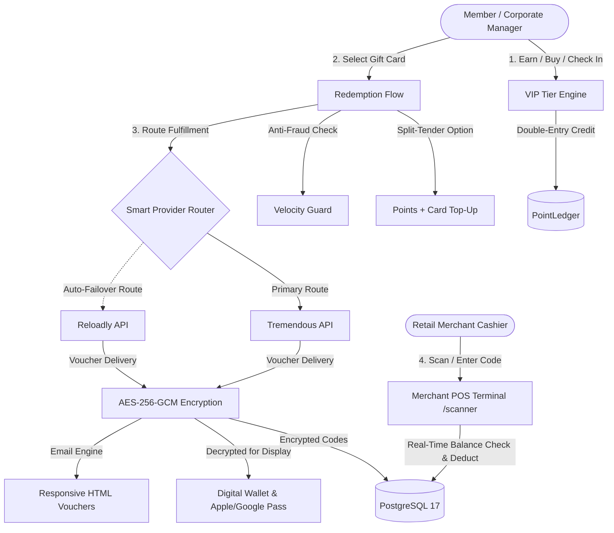

# Nougat - Enterprise Gift Card Loyalty & Rewards Platform

A full-stack, enterprise-grade **Gift Card Loyalty & Digital Rewards Platform** built with **Next.js 14 (App Router, TypeScript)**, **PostgreSQL 17**, **Prisma ORM**, **Dual-Provider Routing (Tremendous & Reloadly)**, **Bank-Grade AES-256-GCM Vault Encryption**, **Split-Tender Checkout**, **B2B Bulk Corporate Rewards**, **Apple Wallet & Google Pay Mobile Passes**, and **International Multi-Currency FX Engine**.

---

## 🏛️ Platform Architecture



---

## 🚀 Core Platform Capabilities

### 1. Rewards Catalog & Consumer Redemption (`/`)
- **Top 9 Global Brands**: Amazon, Apple, Starbucks, Target, Uber, Nike, Spotify, Airbnb, Steam.
- **Dynamic Denominations**: $10, $15, $25, $50, $100, $250, $500 with real-time points calculations ($100\text{ pts} / \$1.00$).
- **Instant Digital Delivery**: High-converting scratch-to-reveal modal, copyable voucher numbers, security PINs, and direct links to official claim portals.

### 2. 💳 Split-Tender Checkout ("Points + Cash Top-up")
- **Solve Shortfalls**: When a member wants a $50 card but only has 2,000 points ($20), Split-Tender allows applying all 2,000 points and paying the remaining $30 with a credit card.
- **Card Payment Simulator**: Pre-authorized test card form with real-time Visa/Mastercard badge detection, expiry, CVC, and 256-bit encryption indicator.
- **ACID Double-Entry Tracking**: Deducts only the applied points, records `cashSpent` and `paymentMethod` in `RedemptionOrder`, and automatically voids the card charge if fulfillment fails.

### 3. 🏢 B2B Corporate & Bulk Employee Rewards (`/bulk-rewards`)
- **Enterprise Incentive Portal**: Distribute spot bonuses and performance awards to entire teams simultaneously.
- **Interactive Recipient Grid**: Add up to 20 recipients per batch, customize individual reward amounts, change brands, and write individualized greetings.
- **One-Click Demo Team**: Pre-populates real employees with Amazon, Starbucks, Apple, and Target cards.
- **Corporate Card Top-Up**: If points are short of the total budget, allows paying the difference with a corporate credit card.
- **Download Batch Audit CSV**: Export complete batch fulfillment reports with recipient names, card codes, PINs, claim URLs, and provider references.

### 4. 📱 Apple Wallet & Google Pay Mobile Pass Simulator (`/wallet`)
- **Native Mobile Pass Aesthetics**: Styled with iPhone Apple Wallet `.pkpass` and Google Pay geometry, metallic sheen, and brand-specific gradients.
- **Contactless NFC & Scannable Codes**: Radio wave NFC symbol with simulated contactless tap checkmark, high-density Aztec QR code, and Code128 barcode for in-store checkout.
- **3D Card Flip**: Hardware-accelerated 3D flip to inspect merchant instructions, provider order IDs, AES-256-GCM tokens, and 24/7 concierge support hotlines.

### 5. 🌍 International Multi-Currency & FX Engine
- **Global Currency Switcher**: Header selector supporting **7 world currencies**:
  - 🇺🇸 **USD** ($ - Base 1.0x)
  - 🇪🇺 **EUR** (€ - 0.92x)
  - 🇬🇧 **GBP** (£ - 0.78x)
  - 🇨🇦 **CAD** (CA$ - 1.36x)
  - 🇦🇺 **AUD** (A$ - 1.52x)
  - 🇮🇳 **INR** (₹ - 83.50x)
  - 🇯🇵 **JPY** (¥ - 155.0x)
- **Dynamic FX Conversions**: Real-time conversions across points equivalents, catalog cards, split-tender card charges, and wallet balances.

### 6. 🔔 Real-Time In-App Notification Center
- **Notification Dropdown**: Bell icon with unread count badge in the header.
- **Real-Time Triggers**:
  - 🎁 Order fulfillment and gift card delivery alerts.
  - 💌 "Gift to a Friend" dispatch confirmations.
  - 🪙 Points accrual, daily streak bonuses (+50 pts), and milestone rewards.
  - ⚠️ Compensating rollback and refund notifications.
  - 🏢 Corporate batch reward completion summaries.

### 7. 🎁 "Gift to a Friend" Personalized Flow
- **Gift Delivery**: Dedicate any gift card to a recipient with recipient name, email, and personal greeting note (*e.g., "Happy Birthday Sophia! Grab a coffee on me ☕"*).
- **Personalized Email**: Recipient receives an HTML gift voucher email with the sender's dedication.
- **Digital Wallet Badges**: Digital cards display `🎁 Gift for: [Recipient Name]`.

### 8. 🛍️ Merchant Point-of-Sale (POS) Scanner (`/scanner`)
- **Cashier Checkout Simulator**: Look up cards by voucher number and PIN.
- **Live Balance Deductions**: Charge partial or full amounts against the voucher, decrementing the card balance and issuing a printable cashier receipt with authorization approval codes (`AUTH-XXXXXX`).

### 9. 🔀 Dual-Provider Routing with Automatic Failover
- **Integrated Providers**: Tremendous API and Reloadly API.
- **Smart Failover Router**: Automatically routes through primary provider; if a stock outage or network error occurs, seamlessly falls back to the secondary provider without user disruption.
- **Manual Override**: Option in UI to force Tremendous, Reloadly, or Auto-Failover.

### 10. 🔒 Bank-Grade Security & Anti-Fraud
- **AES-256-GCM Vault Encryption**: Voucher codes and PINs are encrypted at rest with unique 96-bit IVs and 128-bit authentication tags before storage in PostgreSQL (`lib/security/crypto.ts`).
- **Anti-Fraud Velocity Guard**: Enforces maximum 5 redemptions per 10-minute window and 25,000 points daily redemption cap.
- **HMAC-SHA256 Webhooks (`/api/webhooks/tremendous`)**: Signed webhook listener handling asynchronous cancellations and automatic point refunds.

### 11. 🏆 VIP Loyalty Tier Engine
- **Bronze Member** (0–4,999 pts): 1.0x earn rate (10 pts/\$).
- **Silver Member** (5,000–14,999 pts): 1.1x earn rate (11 pts/\$).
- **Gold VIP** (15,000–29,999 pts): 1.25x earn rate (12.5 pts/\$) + 2% redemption discount.
- **Platinum VIP** (30,000+ pts): 1.5x earn rate (15 pts/\$) + 5% redemption discount.

### 12. 📊 Double-Entry Audit Ledger & Financial CSV Export
- **Immutable Ledger (`/history`)**: Complete `EARNED`, `REDEEMED`, `REFUNDED`, `ADJUSTED` audit trail.
- **Export CSV Buttons**: Instant financial download of double-entry transactions (`/history`) and redemption orders (`/orders`).

---

## 🧭 Application Routes

| Route | Feature | Description |
|---|---|---|
| **`/`** | **Rewards Catalog** | 9 brands, currency picker, gift options, live discounts. |
| **`/wallet`** | **Digital Card Wallet** | Active vouchers, live balances, **Apple/Google Mobile Pass**, Print PDF. |
| **`/bulk-rewards`** | **B2B Bulk Rewards** | Team recipient grid, corporate card top-up, batch CSV reports. |
| **`/wallet/print/[orderId]`**| **Print Voucher** | High-resolution printable certificate with Code128 barcode. |
| **`/scanner`** | **Merchant POS Terminal** | Cashier scanner, balance verification, authorization slips (`AUTH-XXXXXX`). |
| **`/history`** | **Points Ledger** | Immutable double-entry audit history with instant **Export CSV**. |
| **`/orders`** | **Orders Audit** | Idempotent redemption orders audit with **Export Orders CSV**. |
| **`/admin`** | **Admin Console** | Financial liabilities, brand toggles, exchange rates, sandbox reset. |
| **`/api/verify`** | **13-Point Test Suite** | Automated end-to-end verification covering all modules. |
| **`/api/stress-test`** | **Double-Spend Test** | 5-way simultaneous concurrency stress test verifying ACID locks. |

---

## 🧪 Automated Testing & Verification

Run the automated verification suite anytime:
```bash
# 13-point system verification test
curl http://localhost:3001/api/verify

# Concurrency double-spend prevention stress test
curl http://localhost:3001/api/stress-test
```

### Verification Checklist:
- [x] Point Earning Simulation with VIP Tier Multiplier
- [x] Safe Redemption & External Provider Delivery (Tremendous Sandbox)
- [x] Dual-Provider Reloadly Integration
- [x] VIP Loyalty Tiers (Bronze, Silver, Gold, Platinum)
- [x] Transactional HTML Email Engine
- [x] ACID Transactional Rollback & Compensating Refunds
- [x] AES-256-GCM Cryptographic Encryption & Decryption (96-bit IV, 128-bit tag)
- [x] Anti-Fraud Velocity Guard & Rate Limiting
- [x] Split-Tender Checkout (Points + Credit Card)
- [x] Real-Time In-App Notification Center
- [x] B2B Corporate Bulk Rewards Batch Execution
- [x] International Multi-Currency & FX Engine (USD, EUR, GBP, CAD, AUD, INR, JPY)
- [x] Immutable Double-Entry Ledger Integrity

---

## 🐳 Docker Deployment

The application includes a production-ready **multi-stage standalone Dockerfile** and **docker-compose.yml**:

```bash
# Run the entire stack (PostgreSQL 17 + Next.js Standalone Runner)
docker-compose up --build
```

---

## 🏃 Running Locally

```bash
# Install dependencies
npm install

# Push database schema & generate Prisma client
npx prisma db push
npx prisma generate

# Seed database with brands & demo users
node prisma/seed.js

# Build production bundle
npm run build

# Start production server
npx next start -p 3001
```
Server runs at `http://localhost:3001`.
